# Java for Networks — TP2: UDP Client and Server

## Step 1 — UDP server

We wrote `UDPServer.java` to receive UDP messages and display each message with the sender's IP address and port. The server uses port 8080 by default.

## Step 2 — Server test with Ncat

We used Ncat on Windows to send `Bonjour` to the server and confirmed that the server displayed the message.

## Step 3 — UDP client

We wrote `UDPClient.java` to send each line typed in the terminal as a UTF-8 UDP datagram to the server address and port given on the command line.

## Step 4 — Two clients sending to the same server

What does the server display when two clients send messages to it?

The server displayed each message along with the sender's IP address and source port. Both clients ran on the same computer, so the server showed the same IP address, `127.0.0.1`, for both. Each client used a different source port, which made it possible to tell them apart.

## Step 5 — UDP receive buffer

With a 64-byte receive buffer, the server receives only the first 64 bytes of any longer datagram. The client receives no notification that the message was truncated. The remaining bytes are discarded, so there is no second datagram containing the rest of the message.

In the Kali test shown below, the client sends a message ending in `B`. The server runs with a 64-byte buffer and displays the leading `A` characters. The final `B` is absent from the server output.

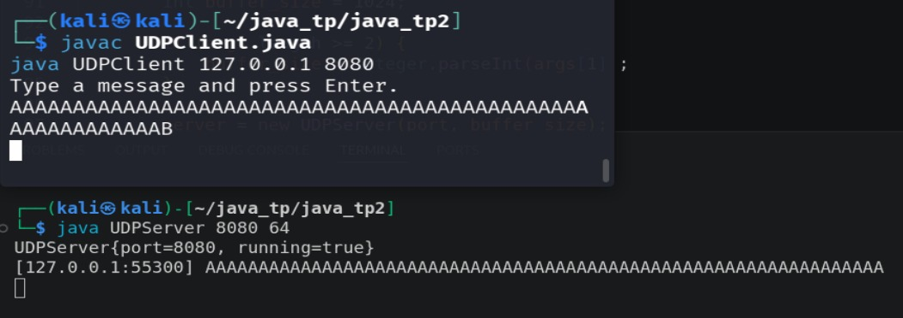
The Kali capture shows the server receiving a long message with a 65,507-byte buffer.

We launched the server with receive buffers of 64, 2,048, and 65,507 bytes. The PowerShell inputs shown used 100 repeated `A` characters for each buffer and a second input of 300 characters with the 65,507-byte buffer.

| Receive buffer size (bytes) | A characters visible in the copied server output |
| ---: | ---: |
| 64 | 50 |
| 2,048 | 50 |
| 65,507 | 50 on the first line, 170 on the second |

The copied output shows shorter strings than expected across all three tests. These excerpts alone do not confirm the number of bytes received.

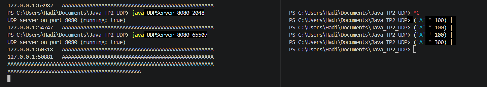

The Kali capture shows the server receiving a long message with a 65,507-byte buffer.

## Step 6 — Maximum UDP datagram size

On Kali, we started the server with `java UDPServer 8080 65507` and ran `java DatagramSizeTest` to send four UDP payloads.

| Payload attempted (bytes) | Client result | Bytes displayed by the server |
| ---: | --- | ---: |
| 1,000 | Sent | 1,000 |
| 10,000 | Sent | 10,000 |
| 65,507 | Sent | 65,507 |
| 65,508 | `Could not send 65508 bytes: Message too long` | No datagram received |

The largest payload that arrived was 65,507 bytes. With a standard 20-byte IPv4 header and an 8-byte UDP header, the maximum UDP payload is 65,535 − 20 − 8 = 65,507 bytes. The final attempt exceeded that limit by one byte.

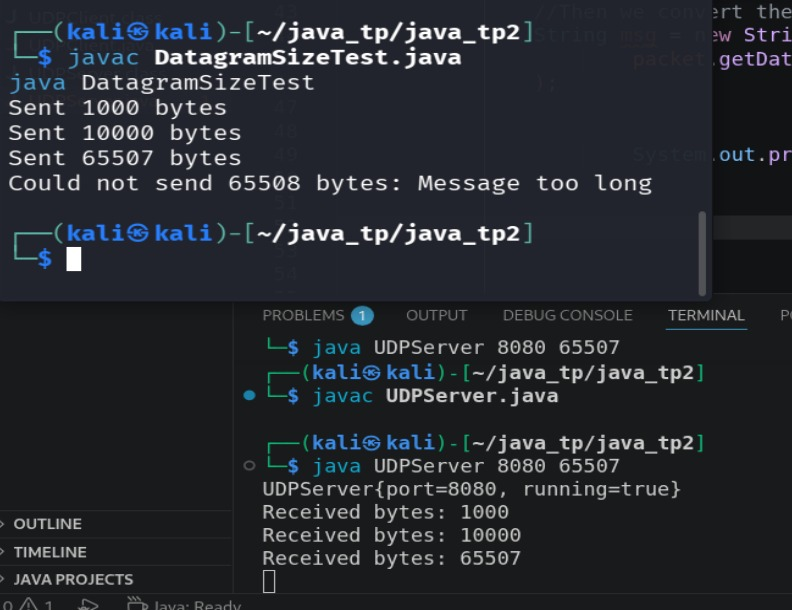

The Windows run with `UDPSizeTest` showed the same limit. Windows reported `The message is larger than the maximum supported by the underlying transport: sendto` for the last send.

## Step 7 — UDP header and IPv4 fragmentation

### Two-PC test — Wireshark observations

The client at `10.104.118.248` sent UDP datagrams to the server at `10.104.118.93:8080`. Wireshark displayed the traffic using the filter `ip.addr == 10.104.118.248`.

| UDP payload (bytes) | Source port | IPv4 packets observed | Wireshark frames |
| ---: | ---: | ---: | --- |
| 100 | 53464 | 1 | 207 |
| 1,000 | 55090 | 1 | 446 |
| 6,500 | 58121 | 5 | 863–867 |

For the 6,500-byte payload, frames 863–866 show four IPv4 fragments with Identification 1526 and offsets of 0, 1,480, 2,960, and 4,440 bytes. Frame 867 carries the fifth fragment. Wireshark displays that frame as UDP with `Len=6500` because reassembly completes there.
The 6,500-byte payload plus the 8-byte UDP header occupies 6,508 bytes. On a link with a 1,500-byte MTU and a 20-byte IPv4 header, four full fragments carry 1,480 bytes each and the final fragment carries 588 bytes. For the 10,000-byte LAN payload requested in the lab, the same calculation gives an **expected count of seven fragments** if fragmentation is allowed.

### Loopback comparison and UDP header fields

On one Windows PC, we sent UDP payloads of 1,000 and 10,000 bytes to `127.0.0.1:8080` and captured the traffic on the loopback interface. Wireshark showed one IPv4 packet per datagram. Both packets had a fragment offset of zero and the More Fragments flag was clear.

| UDP payload (bytes) | UDP Length field (bytes) | IPv4 Total Length (bytes) | IPv4 packets observed |
| ---: | ---: | ---: | ---: |
| 1,000 | 1,008 | 1,028 | 1 |
| 10,000 | 10,008 | 10,028 | 1 |

The four UDP header fields are Source Port, Destination Port, Length, and Checksum. The destination port was 8080. The UDP Length field includes the 8-byte UDP header and the payload.

In the Wireshark screenshot, the source port is 50501, the destination port is 8080, the UDP Length field is 15 bytes, and the checksum is `0x8aa8` (unverified by Wireshark).

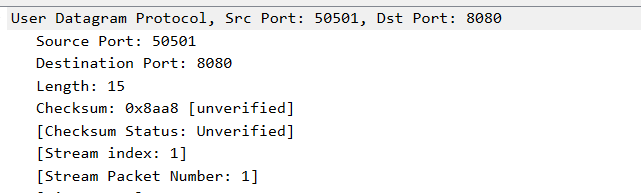

## Step 8 — Receive buffer and datagram size

### a. Why does the receiver choose the receive buffer size?

The receive buffer belongs to the receiving application. It allocates memory based on the message sizes it expects and the available memory. The sender chooses the datagram size. If that datagram is larger than the buffer passed to Java's receive call, the receiver gets only the bytes that fit and the rest are discarded.

### b. Why avoid UDP payloads larger than about 1,400 bytes?

A packet must fit within the smallest MTU along its route. With a 1,500-byte MTU, a standard 20-byte IPv4 header and an 8-byte UDP header leave 1,472 bytes for the payload. Around 1,400 bytes gives some headroom for extra headers. If the packet is too large, it may be fragmented or dropped. When fragmentation occurs, losing one fragment prevents the receiver from reassembling the whole datagram.

## Step 8 — Receive Buffer and Datagram Size

### a. Why does the receiver choose the receive buffer size?

The receive buffer is allocated by the receiving application. The sender decides how many bytes to send, and the receiver decides how many bytes it can read from each datagram. If the client sends 100 bytes and the server uses a 64-byte buffer, the server reads the first 64 bytes and the remaining 36 bytes are discarded.

### b. Why avoid UDP payloads larger than about 1,400 bytes?

With an MTU of 1,500 bytes, a standard 20-byte IPv4 header and an 8-byte UDP header leave 1,472 bytes for the UDP payload. Using about 1,400 bytes leaves some room for additional headers. If an IP packet exceeds the MTU along its route, it may be fragmented or dropped. Losing one fragment prevents the receiver from reassembling the datagram.

## Step 9 — Connectionless UDP

### a. Sending messages before the server starts

The client sent messages before the server was running. Since UDP does not establish a connection or wait for an acknowledgment, the client can send without displaying an error. The messages sent before the server started were discarded. Once the server was listening, it displayed the new message.

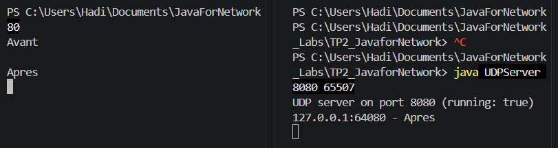

### b. Sending messages to closed UDP ports

When a datagram is sent to a closed UDP port, the destination can reply with an ICMP **Destination Unreachable — Port Unreachable** message (type 3, code 3). In Wireshark, the UDP header embedded in the ICMP reply shows which destination port was unreachable.

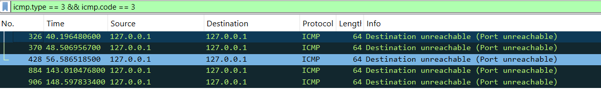

### c. Restarting the client while the server is running

The server kept listening on port 8080 when the client stopped. It received no notification that the client had closed. Both client instances used the same source IP address, `127.0.0.1`, and used different source ports. The operating system assigned a source port each time the client opened a new UDP socket.

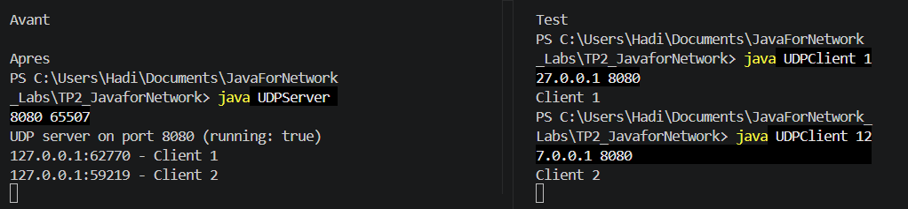

## Step 10 — UDP and TCP

### a. What would happen with TCP in experiments a and c?

In experiment a, the HTTP client from TP1 would first try to establish a TCP connection. On localhost, if no server were listening, the connection would normally be refused. The client would need to try again after the server starts.

In experiment c, the server can detect a normal TCP closure when it reads the end of the stream. Each client restart opens a new TCP connection.

### b. Why is UDP used for DNS, video streaming, and online games?

- **DNS:** A client can send a short query without first opening a connection. It can retry if no answer arrives and switch to TCP if the UDP response is truncated.
- **Real-time video:** A packet that arrives after its playback deadline is of little use. The application can keep playing when a packet is lost.
- **Online games:** Updates such as player positions become outdated quickly. The game can use the latest update and add acknowledgments for important events.

## Step 11 — UDP Sequence Numbers

The client prefixes each message with a sequence number starting at `0`. The server extracts the number and displays it next to the message. In the localhost test, the server received three messages in order and displayed `#0`, `#1`, and `#2`.

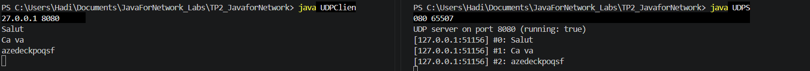

The server also checks the next expected sequence number. For example, if it expects `1` and receives `2`, it reports a gap. If `1` arrives afterward, the server reports it as late or duplicate.

## Step 12 — UDP Acknowledgments and Retransmissions

The server replies to each valid message with `ACK:n`, where `n` is the message's sequence number. It sends the reply to the source IP address and port of the received datagram.

The client waits up to 500 ms for the matching acknowledgment. If it times out, it resends the same datagram with the same sequence number. It stops after three attempts in total and reports an error if no matching acknowledgment arrives.

In the localhost test, the server received message `#0` and the client displayed `Received ACK:0`.

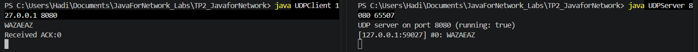

## Step 13 — Measuring UDP Packet Loss

`BurstSender` sent 10,000 numbered UDP datagrams as fast as possible, without waiting for acknowledgments. `BurstReceiver` counted the received datagrams. We calculated the loss rate as `100 × (sent − received) / sent`.

| Test | Receiver delay | Sent | Received | Lost | Loss rate |
| --- | ---: | ---: | ---: | ---: | ---: |
| a. Localhost | 0 ms | 10,000 | 7,554 | 2,446 | 24.46% |
| b. Between two machines | 0 ms | 10,000 | 9,433 | 567 | 5.67% |
| c. Localhost | 5 ms | 10,000 | 223 | 9,777 | 97.77% |
| c. Between two machines | 5 ms | 10,000 | 5,562 | 4,438 | 44.38% |

### a. Localhost without delay

We measured 24.46% packet loss. Even on localhost, a fast burst can fill the operating system's UDP receive queue. Once the queue is full, incoming datagrams can be dropped before the Java program reads them.

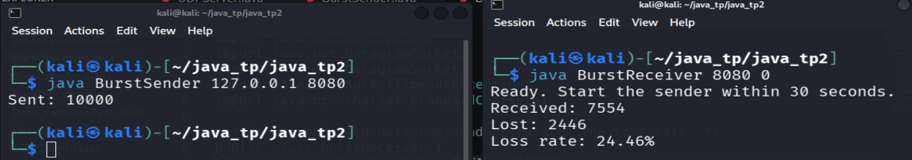

### b. Between two machines without delay

We measured 5.67% packet loss between the two machines. The loss rate depends on how quickly datagrams arrive and how quickly the receiver reads them.

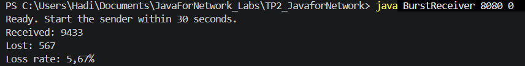

### c. Tests with a 5 ms receiver delay

The receiver waited 5 ms after each datagram. This slowed down the rate at which it emptied its receive queue.

**Localhost.** Packet loss increased from 24.46% to 97.77%.

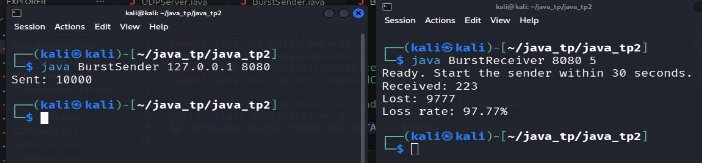

**Between two machines.** Packet loss increased from 5.67% to 44.38%.
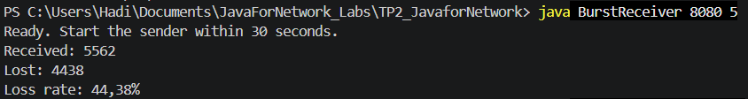

## Step 15 - Retransmission Timeout and Comparison with TCP

### a. How should the timeout be chosen?

The timeout should allow enough time for the message to reach the server and for its acknowledgment to return. It should be based on the measured round-trip time (RTT), with a margin for delays that vary. Our client used a fixed timeout of 500 ms.

- **Too short:** The client may resend a message while its ACK is still on the way. This adds traffic and can create duplicates.
- **Too long:** When a message or ACK is lost, the client waits longer than necessary before retrying. Since it sends one message at a time, later messages are also delayed.

### b. Which TCP mechanisms did we reimplement, and which are still missing?

We added sequence numbers, acknowledgments, retransmissions after a timeout, and duplicate detection. The client waits for each ACK before sending the next message and gives up after three attempts.

Our implementation still lacks TCP's connection setup and teardown, sliding window, flow control, congestion control, and adaptive retransmission timeout. TCP also delivers an ordered byte stream. Our server can report a gap in message numbers, and it can still process later messages if the client gives up on an earlier one.

